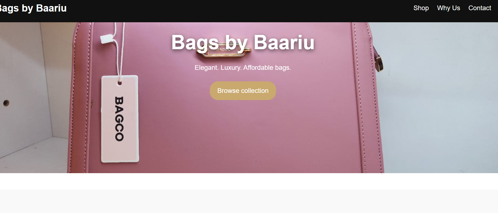
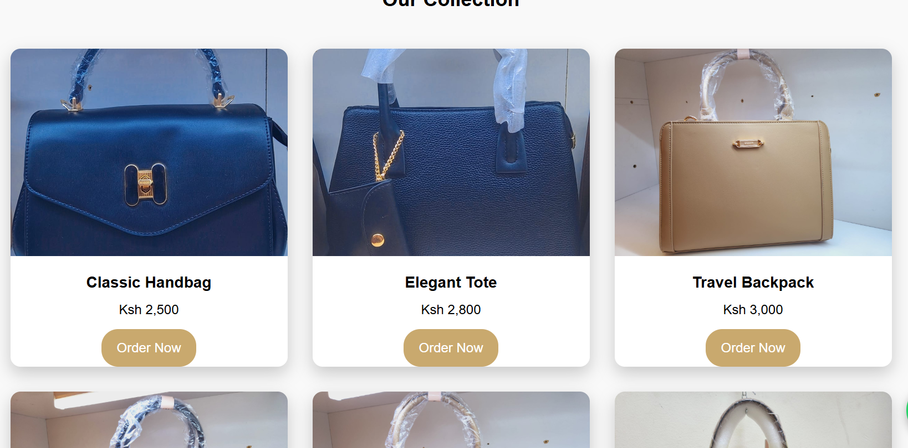
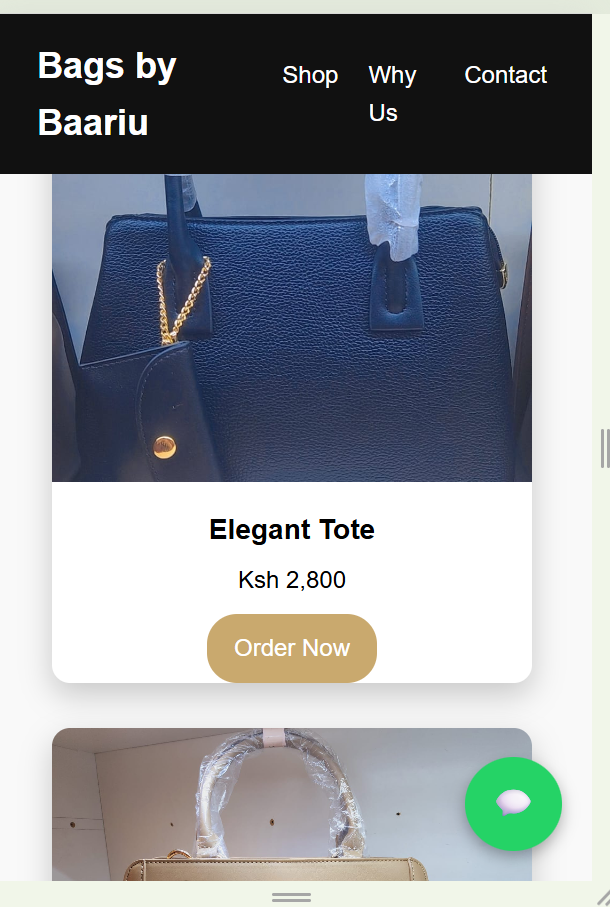

# Bags by Baariu — E-commerce Website

## Project Overview

Bags by Baariu is a responsive product showcase website developed for a handbag and accessories brand. The website presents products, displays pricing, communicates the brand's value proposition, and directs prospective customers to WhatsApp for enquiries and orders.

This project demonstrates the practical application of front-end web development and cloud hosting to support a small business's digital presence.

## Project Objectives

- Establish an online presence for a small retail brand.
- Display products and prices in a clear, accessible layout.
- Provide a direct communication channel for prospective customers.
- Deploy a static website using Amazon Web Services (AWS).
- Practise version control and source-code management using Git and GitHub.

## Features

- Responsive product catalogue.
- Product names and prices.
- Brand introduction and value proposition.
- Navigation links for Shop, Why Us, and Contact.
- WhatsApp links for customer enquiries and orders.
- Mobile-friendly layout.
- Static website hosting on Amazon S3.

## Technologies Used

- **HTML5** — website structure and content.
- **CSS3** — styling, layout, and responsive design.
- **Amazon S3** — static website hosting and asset storage.
- **Git** — local version control.
- **GitHub** — remote repository and project documentation.

## Project Structure

```text
bags-by-baariu/
├── index.html
├── styles.css
├── images/
│   ├── bag1.jpg.jpeg
│   ├── bag2.jpg.jpeg
│   ├── bag3.jpg.jpeg
│   ├── bag4.jpg.jpeg
│   ├── bag5.jpg.jpeg
│   ├── bag6.jpg.jpeg
│   └── bag7.jpg.jpeg
├── screenshots/
├── README.md
└── .gitignore
```

The `images/` directory contains the product images used by the website. The `screenshots/` directory contains visual previews of the project.

## AWS Deployment

The website was deployed as a static site using Amazon S3.

The deployment workflow involved:

1. Preparing the website files locally.
2. Uploading the HTML, CSS, and image assets to the S3 bucket.
3. Configuring the bucket for static website hosting.
4. Checking that the website and its assets loaded correctly.
5. Updating files and verifying changes after deployment.

**Note:** The deployment configuration and public access settings depend on the chosen hosting setup. No AWS credentials or access keys should be stored in this repository.

## Challenges and Lessons Learned

This project provided practical experience in:

- Structuring a website with HTML and CSS.
- Organising image assets and maintaining correct relative file paths.
- Troubleshooting styling and browser caching issues during website updates.
- Deploying and validating a static website on AWS S3.
- Using Git to track changes and GitHub to maintain a remote code repository.

## Future Improvements

- Improve product ordering with product-specific WhatsApp messages.
- Add product categories and filtering.
- Improve image optimisation and page performance.
- Add analytics to understand visitor engagement.
- Explore a custom domain and HTTPS through an appropriate hosting configuration.
- Introduce a backend or e-commerce platform if order management requirements grow.

## Project Purpose

This project forms part of my practical technology portfolio, demonstrating how cloud services and web technologies can support a real-world small-business use case.

## Author

Bags by Baariu project owner and developer.

---

*Built with HTML, CSS, Git, GitHub, and Amazon Web Services.*
## Screenshots

### Homepage


### Product Catalogue


### Mobile View
